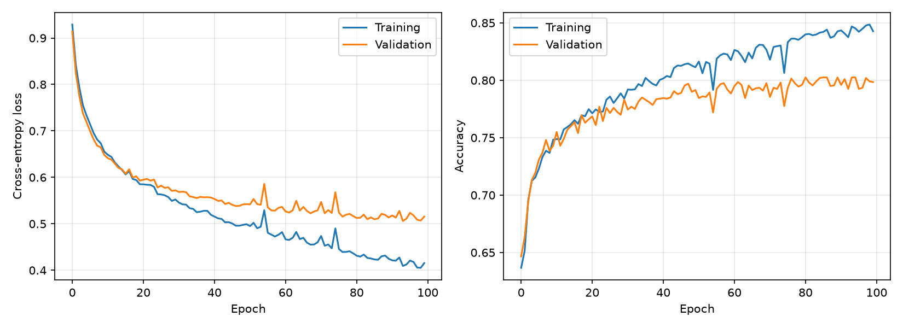
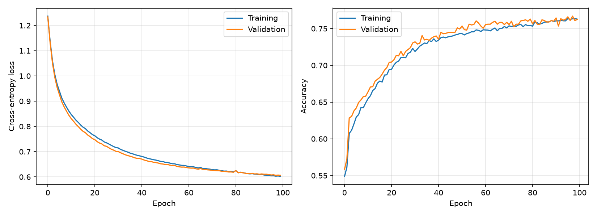

## Project Overview

This project implements a Multilayer Perceptron (MLP) using Python and NumPy to classify four Fashion-MNIST clothing categories: T-shirt/top, Pullover, Coat, and Shirt.

The project focuses on understanding neural network fundamentals through the implementation of forward propagation, backpropagation, and gradient descent without relying on deep learning frameworks such as TensorFlow or PyTorch.

It also compares ReLU and Sigmoid activation functions to evaluate their impact on classification accuracy and training performance.

## Technologies

- Python
- NumPy
- Matplotlib

## Model Architecture

- Input layer: 784 features (28 × 28 grayscale images)
- Hidden layer: 128 neurons
- Output layer: 4 neurons with Softmax
- Loss function: Categorical Cross-Entropy
- Optimization: Mini-batch Gradient Descent
- Activation functions compared: ReLU and Sigmoid

## Experimental Results

| Metric | ReLU | Sigmoid |
|---|---|---|
| Training Accuracy | 84.69% | 76.29% |
| Validation Accuracy | 80.25% | 76.25% |
| Validation Loss | 0.5061 | 0.6063 |

Under the tested configuration, ReLU achieved higher validation accuracy than Sigmoid.

## Training Curves

### ReLU

### Sigmoid

